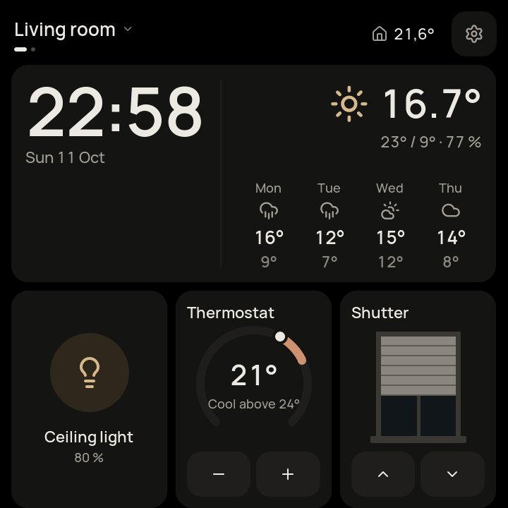
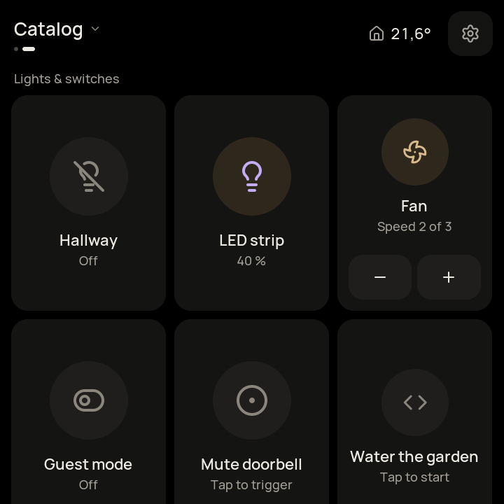
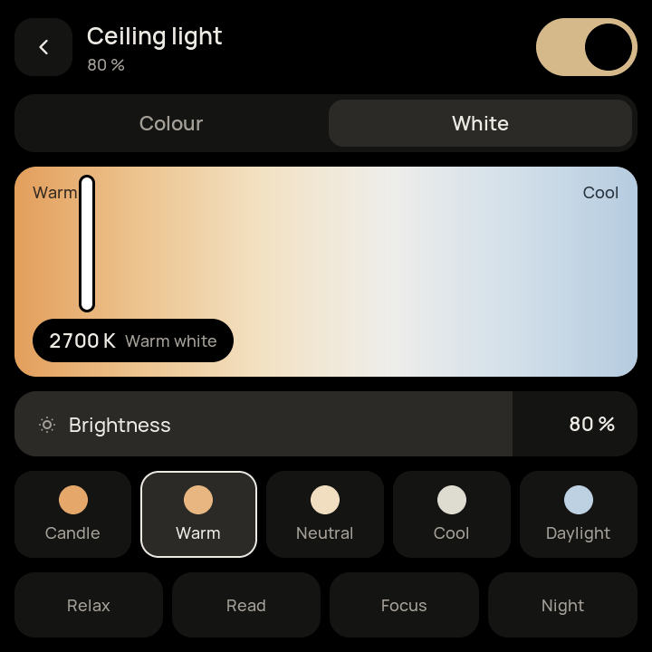
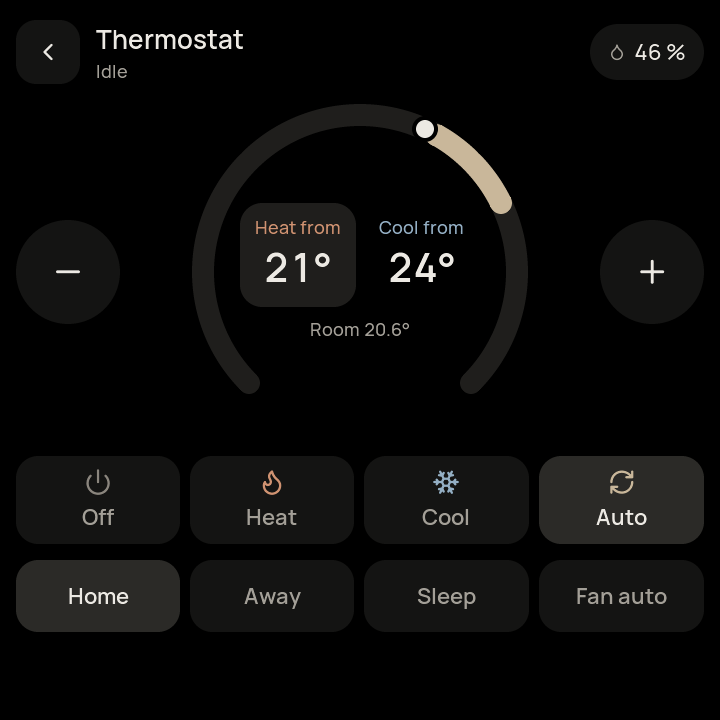
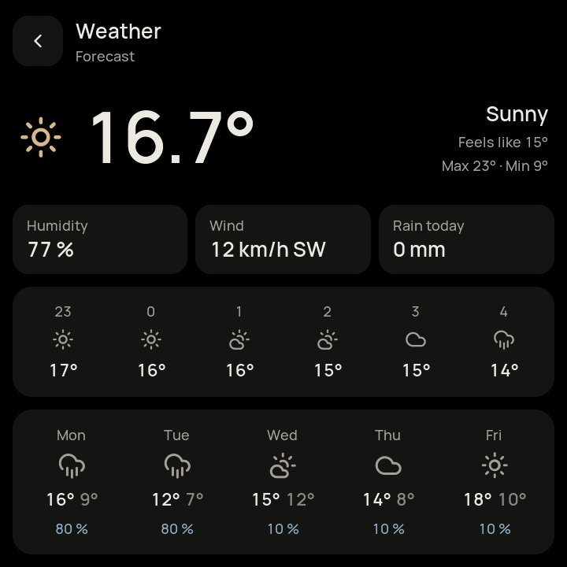
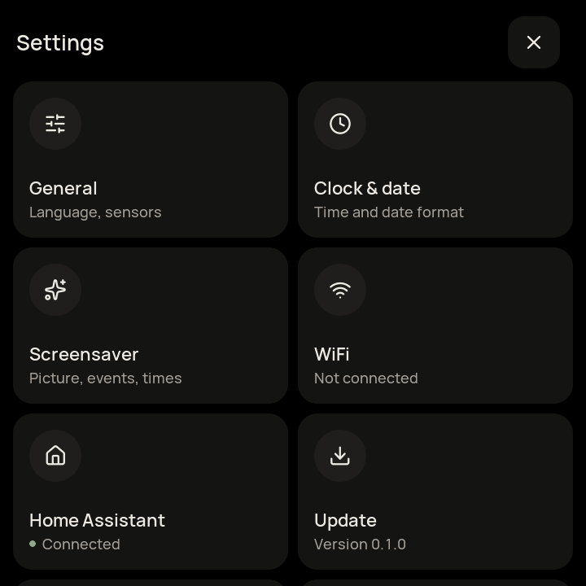

# Homepane

A wall-mounted touch panel for [Home Assistant](https://www.home-assistant.io/), built with [LVGL](https://lvgl.io/) and running natively on the ESP32-P4. No browser, no Linux: Homepane reads your Home Assistant dashboard and renders it as a fast, touch-first tile UI.

> [!WARNING]
> **Work in progress.** Expect rough edges and breaking changes. Do not rely on it for anything safety-relevant (alarm systems, locks) yet.

> [!CAUTION]
> **Homepane updates the firmware of the board's ESP32-C6 (Wi-Fi/Bluetooth co-processor).** During development my board already ran an updated C6 firmware, so I could not test two things: how Homepane works with the factory C6 firmware (which reports version 0.0.0), and the C6 update itself starting from that factory firmware. The update path is only tested from my own 2.7 firmware onwards. Testing this fully needs a new, untouched board, which I have not bought yet. Please proceed with caution: if the C6 ends up with a broken image, recovering it needs a USB-UART connection to the C6. If you prefer to wait, choose *Keep the current Wi-Fi firmware* in the web flasher.

| | | |
|:---:|:---:|:---:|
|  |  |  |
| Dashboard | Tiles for many entity types | Light |
|  |  |  |
| Climate | Weather | Settings |

## Features

- **Your Home Assistant dashboards:** Homepane reads the Lovelace configuration and shows it as tiles, laid out like the sections in Home Assistant; views become pages you swipe between. Switch between several dashboards (e.g. one per room) or use one dashboard with a view per room. Tiles cover most domains (lights, covers, climate, media, sensors, locks, alarm panels, cameras, calendars, weather and more), with detail pages for light, climate, cover, media and weather.
- **Music Assistant:** a pull-down player with cover art, volume, grouping, queue, search and browse.
- **Voice:** works as an [Assist](https://www.home-assistant.io/voice_control/) satellite with an on-device wake word ("Hey Jarvis" or "Okay Nabu").
- **Screensaver:** clock, date and weather on top of a built-in picture or one from your Home Assistant media.
- **Doorbell:** a full-screen overlay with the live camera and *hold to open*.
- **Easy setup:** Wi-Fi setup and Home Assistant pairing through its login page, right on the panel. No token typing.
- **Signed over-the-air updates** with automatic rollback.
- **English and German**, configurable date and time formats.

### Planned

- Timer and alarm clock on the panel
- Sound/EQ page for Music Assistant
- Real on-board sensors (room temperature is currently simulated)
- More ESP32-P4 boards, non-square screens and portrait/landscape ([findings](docs/plans/DISPLAY_SIZES.md))
- A Linux port for Linux-based panels
- A Home Assistant integration / add-on: firmware updates through Home Assistant (also for panels without internet access), optional custom firmware with its own key, and an AI chat that builds custom widgets into it and designs dashboards for the panel ([plan](docs/plans/HA_FIRMWARE_BUILDER.md))

## Supported hardware

[Waveshare ESP32-P4-WIFI6-Touch-LCD-4B](https://www.waveshare.com/): 4" 720 × 720 touch display, ESP32-P4 with an ESP32-C6 for Wi-Fi. A microSD card is optional (cover cache, `config.ini` import).

## Installing

1. Open the **[Homepane Web Flasher](https://schaeck-core.github.io/Homepane/)** in Chrome or Edge on a desktop computer.
2. Choose whether the ESP32-C6 Wi-Fi firmware should be installed too (see the caution above). Without it, the panel never updates the C6; you can turn this on later in *Settings → Update*.
3. Connect the board over USB and click *Install*.
4. After flashing, the flasher asks for your Wi-Fi and sends it to the panel. You can also skip this and choose the network on the panel.
5. On the panel: enter your Home Assistant URL, confirm the login, then choose the default dashboard and the dashboard mode (see below).

The panel then loads your default dashboard. New releases arrive over the air (*Settings → Update*).

## Setting up dashboards

Homepane shows the dashboards you build in Home Assistant, in the **Sections** view type. Build them for the panel: they do not have to look good on a phone as well.

- **One dashboard per room, or one view per room.** In the mode *Several dashboards* the title at the top left switches between all dashboards the panel's Home Assistant user can see; the views of a dashboard are swiped. A dashboard picked there stays until the screensaver starts, then the panel returns to its default dashboard. In the mode *Single dashboard* the top left lists the views of one dashboard. Choose the mode during setup or later in *Settings > Home Assistant*, together with the default dashboard.
- **Which dashboards appear:** set each dashboard's visibility per user in Home Assistant. A dedicated user for the panel keeps its list short.
- **Columns:** the view's *Max number of sections wide* (`max_columns`) sets the panel's columns; each view can have its own. A section spans its `column_span` columns, and sections fill the rows like in Home Assistant.
- **Card sizes:** a card's width is its share of the section, rounded to whole columns for big cards (lights, thermostats, charts, a tile with 4 rows) and to half columns for small cards (tiles, entity and button cards up to 2 rows high, shown as compact tiles a third of a tile high). Example: in a section over 3 columns, a clock with 15 and a weather card with 21 of the 36 units become one and two columns.
- **Rows:** *Settings > General > Tile rows* sets how many tiles fit on the screen from top to bottom: a fixed number (default 2) or relative to the view's columns (*Columns − 1*, *Like columns*), which keeps tiles evenly shaped in views with more columns.

- **Settings in the dashboard:** a `homepane` object in the dashboard's raw configuration (or in a view) sets the rows for the panel and wins over its settings, e.g. `"homepane": {"rows": "3"}`.
- **Changes:** when you save a dashboard in Home Assistant's editor, the panel reloads it by itself and stays on the same view. Dashboards written in YAML send no such notice: reload them with the button next to *close* in the menu at the top left.

If something looks too tight on the panel, change the dashboard: fewer columns, wider cards or fewer rows.

## Building it yourself

```bash
git clone --recursive https://github.com/schaeck-core/Homepane.git
cd Homepane
```

### Simulator (macOS, Linux, Windows)

The simulator runs the same app in a desktop window, either against your Home Assistant or with built-in demo data.

Prerequisites:
- **macOS:** `brew install cmake sdl2`
- **Debian/Ubuntu:** `sudo apt install cmake build-essential libsdl2-dev pkg-config`
- **Windows:** CMake, Git, Python and Visual Studio 2022 (*Desktop development with C++*)

```bash
./setup.sh                  # macOS / Linux (Windows: .\setup.ps1), installs dependencies and builds
HOMEPANE_DEMO=1 ./bin/main  # demo data, no Home Assistant needed
./bin/main                  # your Home Assistant
```

> [!NOTE]
> Connected to a real Home Assistant, taps in the simulator switch real devices. Use the demo mode to try things out.

### Firmware

Requires [ESP-IDF v5.5.1](https://docs.espressif.com/projects/esp-idf/en/v5.5.1/esp32p4/get-started/).

```bash
. ~/esp/v5.5.1/esp-idf/export.sh
platforms/esp32c6_coprocessor/build.sh   # C6 firmware, bundled into the P4 image
cd platforms/esp32p4
idf.py build
idf.py -p <PORT> flash
```

Over-the-air updates only accept firmware signed with the project's key, so a self-built firmware has to be flashed over USB.

## Building your own widgets

The [design guide](docs/design/DESIGN_GUIDE.md) describes the design language and walks through [building a new dashboard widget](docs/design/DESIGN_GUIDE.md#building-a-new-widget) step by step. Together with [AGENTS.md](AGENTS.md) it is written so that you can hand it to an AI coding assistant such as [Claude Code](https://claude.com/claude-code) and have it build custom widgets for you.

Keep in mind: a panel running your own build has to be flashed over USB, and it no longer receives the official over-the-air updates.

## How this project is developed

Homepane started as a hand-written C project. Progress was slow. With the help of AI coding assistants (currently [Claude Code](https://claude.com/claude-code)) I migrated the core to C++, and since then development has sped up considerably. I still drive the architecture, review the changes and test every feature on real hardware. Bug reports and reviews are very welcome.

## Security

Credentials (Home Assistant token, Wi-Fi, Music Assistant) are stored unencrypted on the panel's flash, so create a dedicated Home Assistant user for it. Please report vulnerabilities privately via [GitHub Security Advisories](https://github.com/schaeck-core/Homepane/security/advisories/new).

## License

Homepane is licensed under the [Apache License 2.0](LICENSE).

Third-party components keep their own licenses: [LVGL](https://github.com/lvgl/lvgl) and the [lv_port_pc_vscode](https://github.com/lvgl/lv_port_pc_vscode) template (MIT, [notice](LICENSES/lv_port_pc_vscode-MIT.txt)), [ESP-IDF](https://github.com/espressif/esp-idf) and [ESP-Hosted](https://github.com/espressif/esp-hosted) (Apache 2.0), [cJSON](https://github.com/DaveGamble/cJSON) (MIT), [libwebsockets](https://libwebsockets.org/) (MIT), [curl](https://curl.se/) (curl license), [libmicrohttpd](https://www.gnu.org/software/libmicrohttpd/) (LGPL 2.1+, simulator only, linked dynamically), [SDL2](https://www.libsdl.org/) (zlib, simulator only), [stb_image](https://github.com/nothings/stb) (MIT / public domain), [TJpgDec](http://elm-chan.org/fsw/tjpgd/) (BSD-style), [Manrope](https://github.com/sharanda/manrope) and [Roboto](https://github.com/googlefonts/roboto) (SIL OFL 1.1), [Lucide](https://lucide.dev/) (ISC), [microWakeWord](https://github.com/kahrendt/microWakeWord) models (Apache 2.0).
